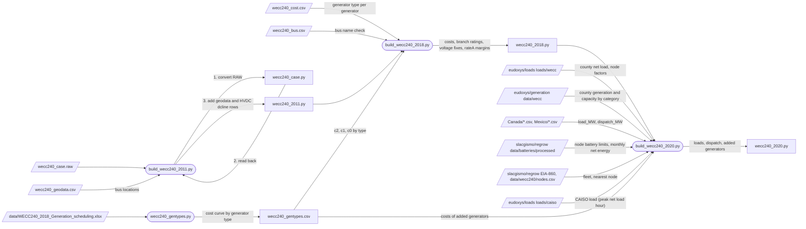

# WECC 240 models

## `wecc240_2011`

This model was produced by CAISO in 2011. The model does not require external
data to load or run. This model is a static model with no time-series
capabilities and can be run in `pypower` or `pypower_sim`.

The static pseudo-DC line gen/load models in the 2011 model are converted to explicit DC lines and costs.

## `wecc240_2018`

This model was produced by NREL in 2018. The model is based on the
`wecc240_2011` model with the `scheduling.py` script run to apply
modifications to the generation fleet, line flow limits, and energy storage.
This model is a static model with no time-series capabilities and can be run
in `pypower` or `pypower_sim`.

### Energy Storage

The energy storage control strategy is scheduled based on the anticipated
response to the "duck-curve" in CAISO, i.e., charging from 9am to 3pm, and
discharging from 3pm to 9pm. Note that the benefits of the energy storage
control strategy are not fully realized without a time-series simulation.

## `wecc240_2020`

The static `wecc240_2020` case is the `wecc240_2018` network at the hour of
the peak CAISO net load in 2020 (2020-09-07 01:00 UTC, 18:00 PDT on 6
September; `-t` sets another hour), built by `build_wecc240_2020.py`:

- Bus loads are node net loads from `eudoxys/loads` at the hour: each
  county's calibrated gross load (`loads/wecc/wecc_estimate.csv.gz`) less
  its distributed solar (`county_dg.csv.gz`), allocated to nodes with
  `node_estimate_cf.csv`, plus the `load_MW` of the Canadian and Mexican
  node files. A node's load is split among its buses by their 2018 `PD`,
  keeping each bus's `QD/PD`.
- The US generator fleet is replaced by the EIA-860 fleet of the year (the
  WECC generators operating at the hour, from the EIA-860 workbooks in
  `slacgismo/regrow`), each plant assigned to its nearest node by
  great-circle distance as REGROW's `nearest2()` does. The county capacity
  and output of `eudoxys/generation` (`data/wecc/capacity_*.csv.gz`,
  `actual_*.csv.gz`) are split among each county's units of a category by
  nameplate and summed by node, in place of `eudoxys/generation`'s
  county-to-node map. Each node and category gets one generator:
  dispatchable categories get `Pmax` the node capacity; solar and wind get
  `Pmax = Pg` the node output.
- Dispatch: the dispatchable generators are dispatched by an OPF with the
  others fixed (solar, wind, batteries, Canada and Mexico), and the case
  keeps the OPF's `Pg`, `Qg` and voltages as setpoints. The OPF is
  infeasible with the 2018 branch ratings at the peak hour (it needs
  `rateA` × 2), so the branches loaded above `rateA` in the resulting power
  flow get `rateA` (and `rateB`, `rateC` where lower) raised to the flow
  over 0.8, as `build_wecc240_2018.py` does (21 branches at the default
  hour; the build lists them).
- Costs: a node's generator gets the `Pmax`-weighted cost of the node's 2018
  generators of its category, else that of the category; oil and other get
  the most expensive 2018 gas cost (`TG`); pumped storage, solar, wind and
  hydro cost 0. The 2018 reactive limits of each node's generators go to its
  new generators.
- Battery storage comes from the battery data of `slacgismo/regrow` PR #91
  (EIA-860/923): one zero-cost generator per node in
  `node_reactive_bounds_by_year.csv` for the year, with `Pmin` the negative
  of the maximum charge rate, `Pmax` the maximum discharge rate, `Q` limits
  ±`reactive_MVAR`, and `Pg` the node's mean net output for the month from
  `node_generation_by_month.csv` (0 where the node did not report).
- Canadian and Mexican generators are dispatched to the node files'
  `dispatch_MW` (Alberta, which has no generator in the case, gets one).

Its OPF and power flow solve; the power flow has no branch above `rateA`
and voltages within 0.900-1.101 pu. The hourly time-series model, designed
to be run using `pypower_sim`, is in progress.

### Load Curtailment

Load curtailment is implemented in three regimes:

1. During normal operations, no load curtailment is specified.
2. When node-level load is within 10% of the line import capacity plus generation of the node, "level 0" load curtailment is enabled, i.e., 10% of the load at the node is made available for curtailment.
3. When area-level load is within 15% of the line import capacity plus generation of the area, "level 1" load curtailment is enabled, i.e., 15% of the load in the area is made available for curtailment.

## `wecc240_2025`

This model was produced by LLNL in 2026 and reflects the system in Q3 2025.
The model is based on the `wecc240_2020` model with updates for new
generation and new loads, including data centers.

## PYPOWER case files

`wecc240_2011.py` and `wecc240_2018.py` are PYPOWER case files generated from
the PSS/E RAW file by the build scripts below; they replace the earlier
`pypower_sim` model modules of the same names.

| File | Description |
| ---- | ----------- |
| `wecc240_case.raw` | 2011 WECC 240-bus case as PSS/E revision 34 (same as `PSSE/wecc240_psse.raw`) |
| `wecc240_case.py` | that case converted by `build_wecc240_2011.py`, without geodata; generated, don't edit |
| `wecc240_map.py` | the case with its `geodata` and `geotags` |
| `wecc240_2011.py` | the 2011 case with geodata; Pacific DC Intertie and Intermountain lines as `dcline` rows; generated, don't edit |
| `wecc240_2018.py` | `wecc240_2011.py` with generator costs by type, branch ratings, voltage fixes and `rateA` margins; generated, don't edit |
| `wecc240_2020.py` | `wecc240_2018.py` network with the EIA-860 fleet, loads and OPF dispatch at the 2020 peak CAISO net load hour; generated, don't edit |
| `wecc240_bus.csv` | bus index (row, PSS/E bus number, name, PYPOWER `bus_i`) |
| `wecc240_cost.csv` | one cost row per generator (`id` is bus name and PSS/E generator ID) |
| `wecc240_gentypes.csv` | polynomial costs (`c2,c1,c0`) by generator type |
| `wecc240_geodata.csv` | bus locations (same as `gis/wecc240.csv`) |
| `wecc240_gentypes.py` | derives `wecc240_gentypes.csv` from `data/WECC240_2018_Generation_scheduling.xlsx` (needs `openpyxl`) |
| `build_wecc240_2011.py` | builds `wecc240_case.py` and `wecc240_2011.py` from `wecc240_case.raw` and `wecc240_geodata.csv` |
| `build_wecc240_2018.py` | builds `wecc240_2018.py` from `wecc240_2011.py` and the cost CSVs |
| `build_wecc240_2020.py` | builds `wecc240_2020.py` from `wecc240_2018.py`, `eudoxys/loads`, `eudoxys/generation` and `slacgismo/regrow` battery data |
| `_case.py`, `_psse.py`, `_dcline.py` | private modules used by the build scripts: case model, PSS/E RAW reader, DC line solver |

### Data flow

Slanted boxes are source files, rounded boxes are scripts, and rectangles are
generated files.

`wecc240_gentypes.py` needs `openpyxl` and is run only to rederive the type
costs; `wecc240_gentypes.csv` is checked in.

### Generator types

The `type` codes in `wecc240_gentypes.csv` are PSS/E generator IDs, the
suffix of each `id` in `wecc240_cost.csv`. Their meaning comes from the
`Gen_Type` column of the `Generator` sheet in
`data/WECC240_2018_Generation_scheduling.xlsx`. The table maps them to the
EIA fuel categories of the node capacity files
(`data/wecc/node_capacity_<fuel>.csv.gz`) in `eudoxys/generation`. Units
and MW are NREL's 2018 counts and `Pmax` totals.

| Fuel category | Type codes | NREL `Gen_Type` | Units | MW |
| ------------- | ---------- | --------------- | ----: | -: |
| `coal` | `C` | Steam | 16 | 44,596 |
| `coal` (probable) | `E` | Steam | 3 | 2,281 |
| `natural_gas` | `G`, `CG`, `DG`, `EG`, `MG`, `NG`, `RG`, `SG`, `TG`, `WG` | Gas | 39 | 108,628 |
| `nuclear` | `N`, `NN` | Nuclear | 3 | 7,733 |
| `hydro` | `H`, `NH`, `SH` | Hydro-3 | 25 | 60,480 |
| `wind` | `W`, `NW`, `SW`, `R` | Wind-2 | 18 | 21,140 |
| `solar` | `S`, `NP`, `P` | PV-2 | 22 | 32,564 |
| `geothermal` | `CE`, `NE` | Geothermal | 2 | 1,957 |
| `biomass` | `B`, `NB` | Biomass | 5 | 1,841 |
| `pumped_storage` | none | ESS-2 (`ESS` sheet) | 4 | |
| `oil`, `other` | none | | | |
| `battery_storage` | none (2020: `slacgismo/regrow` battery data) | | | |

- `E` (IMPERIAL, MEXICO, VALMY) is Steam in NREL's data like `C`, and its
  marginal cost (`c1` 3.663 $/MWh, against 2.496 for `C` and 39–60 for the
  gas codes) is coal-like; VALMY is a coal plant. The other two units are
  not confirmed, so `E` may be other steam.
- Pumped storage has no generator code: NREL models it as `Pump_ESS1`–`4`
  in the `ESS` sheet (buses 2638, 7031, 7032 and 3432), which are not
  generators in the case.
- `SC` (SANMATEO, COLOEAST) and `ND` (MESA CAL, MIDWAY, TESLA) have no NREL
  unit and no fuel category. `SC` units have `Pmax` 0.1 MW and ±500 to
  ±1000 MVAr, i.e., synchronous condensers. `ND` units have `Pmax` 0 and
  `Pmin` from −449 to −1006 MW, so they only absorb power; their meaning is
  not documented.
- The node capacity files are keyed by node geohash, not bus, and a node can
  carry several type codes (e.g., `COLOEAST_P` and `COLOEAST_SC`).

## Rebuilding cases from RAW file

Rebuild the cases from the RAW file with

    python3 wecc240/build_wecc240_2011.py
    python3 wecc240/build_wecc240_2018.py
    python3 wecc240/build_wecc240_2020.py

(only the last two are needed after changing the costs).
`build_wecc240_2020.py` reads `loads/wecc` of `eudoxys/loads` and
`data/wecc` of `eudoxys/generation` from sibling clones of those
repositories if present, otherwise from GitHub (about 200 MB), and the
EIA-860 workbooks, node coordinates and battery data of `slacgismo/regrow`
(sibling clone, otherwise PR #91's head commit on GitHub); use `-l FOLDER`,
`-g FOLDER`, `-r FOLDER` and `-b FOLDER` to name other copies (reading the EIA-860 workbooks needs `openpyxl`), and `-t TIMESTAMP` for
another hour.

### Provenance of `wecc240_gentypes.csv`

`wecc240_gentypes.csv` is generated by `wecc240_gentypes.py` from the
`Generator` sheet of NREL's `data/WECC240_2018_Generation_scheduling.xlsx`.
That sheet names each unit `<bus><ID>` (e.g. `1032G`) and gives its
`Gen_Type`, start-up and no-load costs, and a marginal cost curve of up to
four segments (`CostN` $/MWh up to `MWN`, from `Pmin`). The type is the
unit name without the bus number, which is the PSS/E generator ID in
`wecc240_case.raw` (`C`, `G`, `NG`, ...).

For each type:

- `c1` is the first-segment marginal cost, averaged over the type's units
  weighted by `Pmax`;
- `c2` makes each unit's variable cost from `Pmin` to `Pmax` match its
  curve, scaled to the type's median unit size, so it is too steep for
  units much larger than the median and too flat for smaller ones;
- `c0` is 0 (no-load costs are printed by the script for reference only).

Zero-priced segments after a priced one (units whose `Pmax` was raised for
2018 past the end of their curve) take the last price. Types with no NREL
unit, and types NREL prices at 0 (hydro, wind, solar, geothermal, biomass,
one nuclear unit), are written as all zeros.

The workbook was added to the repository on 2026-06-23 (commit `058d782`)
without a record of where it was obtained; no URL, DOI or version is
documented. The 2018 model is NREL's update of the 2011 CAISO case (Price
and Goodin, 2011); the related NREL publication is Yuan et al., 2020
(doi:10.1109/TD39804.2020.9299666), but that paper is not confirmed as the
workbook's source.

`PSSE/wecc240_psse_gentypes.csv` is unrelated: it is an all-zero
placeholder created by the legacy `PSSE/raw2py.py`.
