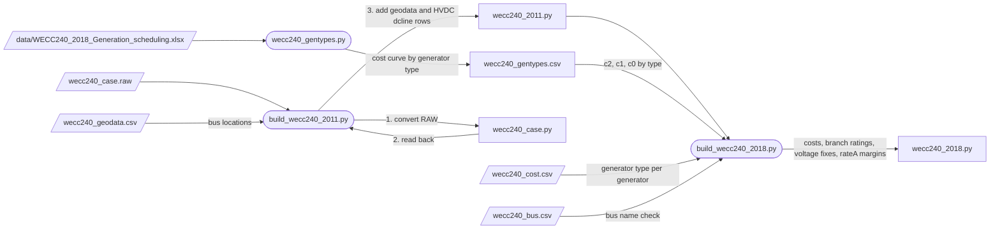

# WECC 240 models

## `wecc240_2011`

This model was produced by CAISO in 2011. The model does not require external
data to load or run. This model is a static model with no time-series
capabilities and can be run in `pypower` or `pypower_sim`.

The static pseudo-DC line gen/load models in the 2011 model are converted to explicit DC lines and costs.

## `wecc240_2018`

This model was produced by NREL in 2018. The model is based on the
`wecc240_2011` model with the `scheduling.py` script run to apply
modifications to the generation fleet, line flow limits, and energy storage.
This model is a static model with no time-series capabilities and can be run
in `pypower` or `pypower_sim`.

### Energy Storage

The energy storage control strategy is scheduled based on the anticipated
response to the "duck-curve" in CAISO, i.e., charging from 9am to 3pm, and
discharging from 3pm to 9pm. Note that the benefits of the energy storage
control strategy are not fully realized without a time-series simulation.

## `wecc240_2020`

This model was produced by NRL in 2026. The model is based on the
`wecc240_2018` model with the `aggregate_load.py` and `aggregate_gens.py`
scripts run to apply modifications to the loads and generation resources.
This model a quasi-steady time-series model designed to be run using
`pypower_sim`. 

### Load Curtailment

Load curtailment is implemented in three regimes:

1. During normal operations, no load curtailment is specified.
2. When node-level load is within 10% of the line import capacity plus generation of the node, "level 0" load curtailment is enabled, i.e., 10% of the load at the node is made available for curtailment.
3. When area-level load is within 15% of the line import capacity plus generation of the area, "level 1" load curtailment is enabled, i.e., 15% of the load in the area is made available for curtailment.

## `wecc240_2025`

This model was produced by LLNL in 2026 and reflects the system in Q3 2025.
The model is based on the `wecc240_2020` model with updates for new
generation and new loads, including data centers.

## PYPOWER case files

`wecc240_2011.py` and `wecc240_2018.py` are PYPOWER case files generated from
the PSS/E RAW file by the build scripts below; they replace the earlier
`pypower_sim` model modules of the same names.

| File | Description |
| ---- | ----------- |
| `wecc240_case.raw` | 2011 WECC 240-bus case as PSS/E revision 34 (same as `PSSE/wecc240_psse.raw`) |
| `wecc240_case.py` | that case converted by `build_wecc240_2011.py`, without geodata; generated, don't edit |
| `wecc240_map.py` | the case with its `geodata` and `geotags` |
| `wecc240_2011.py` | the 2011 case with geodata; Pacific DC Intertie and Intermountain lines as `dcline` rows; generated, don't edit |
| `wecc240_2018.py` | `wecc240_2011.py` with generator costs by type, branch ratings, voltage fixes and `rateA` margins; generated, don't edit |
| `wecc240_bus.csv` | bus index (row, PSS/E bus number, name, PYPOWER `bus_i`) |
| `wecc240_cost.csv` | one cost row per generator (`id` is bus name and PSS/E generator ID) |
| `wecc240_gentypes.csv` | polynomial costs (`c2,c1,c0`) by generator type |
| `wecc240_geodata.csv` | bus locations (same as `gis/wecc240.csv`) |
| `wecc240_gentypes.py` | derives `wecc240_gentypes.csv` from `data/WECC240_2018_Generation_scheduling.xlsx` (needs `openpyxl`) |
| `build_wecc240_2011.py` | builds `wecc240_case.py` and `wecc240_2011.py` from `wecc240_case.raw` and `wecc240_geodata.csv` |
| `build_wecc240_2018.py` | builds `wecc240_2018.py` from `wecc240_2011.py` and the cost CSVs |
| `_case.py`, `_psse.py`, `_dcline.py` | private modules used by the build scripts: case model, PSS/E RAW reader, DC line solver |

### Data flow

Slanted boxes are source files, rounded boxes are scripts, and rectangles are
generated files.

`wecc240_gentypes.py` needs `openpyxl` and is run only to rederive the type
costs; `wecc240_gentypes.csv` is checked in.

Rebuild the cases from the RAW file with

    python3 wecc240/build_wecc240_2011.py
    python3 wecc240/build_wecc240_2018.py

(only the second is needed after changing the costs).

### Provenance of `wecc240_gentypes.csv`

`wecc240_gentypes.csv` is generated by `wecc240_gentypes.py` from the
`Generator` sheet of NREL's `data/WECC240_2018_Generation_scheduling.xlsx`.
That sheet names each unit `<bus><ID>` (e.g. `1032G`) and gives its
`Gen_Type`, start-up and no-load costs, and a marginal cost curve of up to
four segments (`CostN` $/MWh up to `MWN`, from `Pmin`). The type is the
unit name without the bus number, which is the PSS/E generator ID in
`wecc240_case.raw` (`C`, `G`, `NG`, ...).

For each type:

- `c1` is the first-segment marginal cost, averaged over the type's units
  weighted by `Pmax`;
- `c2` makes each unit's variable cost from `Pmin` to `Pmax` match its
  curve, scaled to the type's median unit size, so it is too steep for
  units much larger than the median and too flat for smaller ones;
- `c0` is 0 (no-load costs are printed by the script for reference only).

Zero-priced segments after a priced one (units whose `Pmax` was raised for
2018 past the end of their curve) take the last price. Types with no NREL
unit, and types NREL prices at 0 (hydro, wind, solar, geothermal, biomass,
one nuclear unit), are written as all zeros.

The workbook was added to the repository on 2026-06-23 (commit `058d782`)
without a record of where it was obtained; no URL, DOI or version is
documented. The 2018 model is NREL's update of the 2011 CAISO case (Price
and Goodin, 2011); the related NREL publication is Yuan et al., 2020
(doi:10.1109/TD39804.2020.9299666), but that paper is not confirmed as the
workbook's source.

`PSSE/wecc240_psse_gentypes.csv` is unrelated: it is an all-zero
placeholder created by the legacy `PSSE/raw2py.py`.
