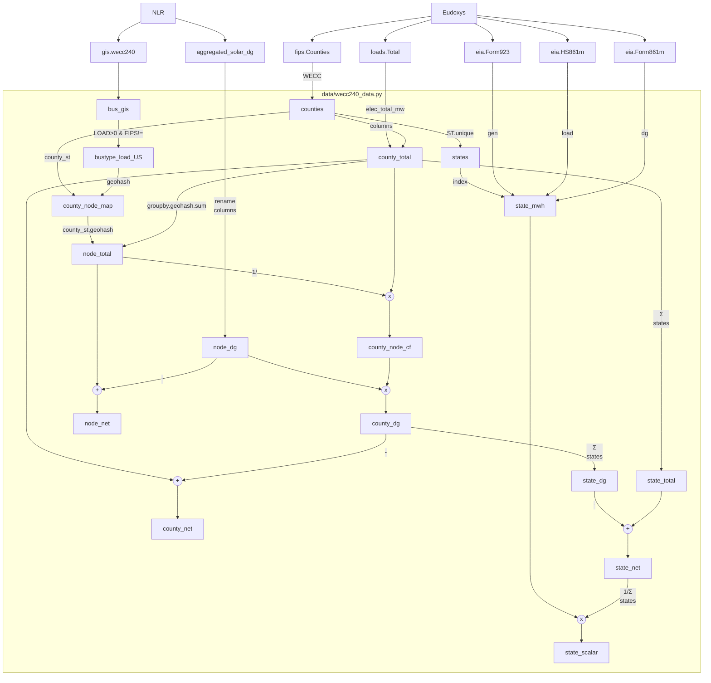

## WECC 240 model data flow

## Form 930 balancing authority load

`form930_load_2020.csv.gz` holds the EIA Form 930 hourly demand (`load_mw`,
MW, UTC hour-beginning `timestamp`) of the 28 US load-serving balancing
authorities in WECC in 2020, as returned by `eia.Form930` of `eudoxys/eia`.
It was written by `form930_load.py` (`python3 form930_load.py 2020`) on
2026-11-18 with `eudoxys/eia` at commit `a2bd69b`. The values are raw:
`build_wecc240_2020.py` drops spikes before taking each authority's peak.
PSEI has only 109 hours of data in 2020.
