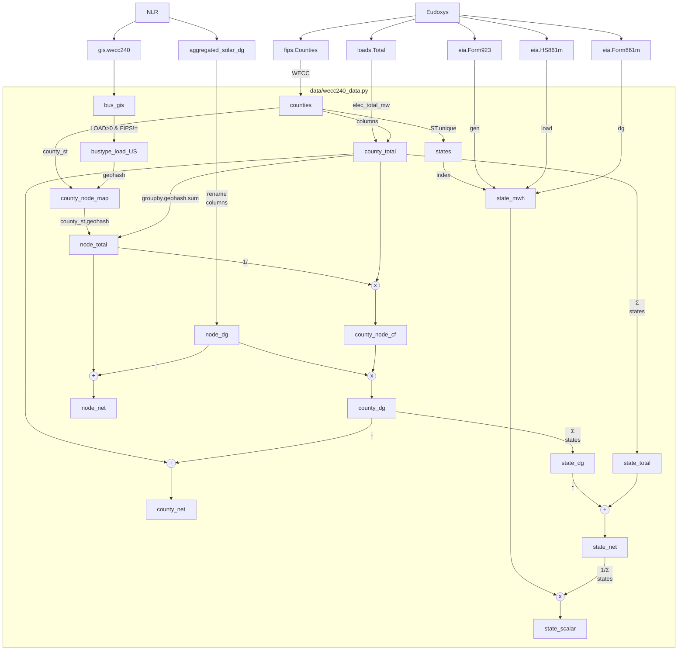
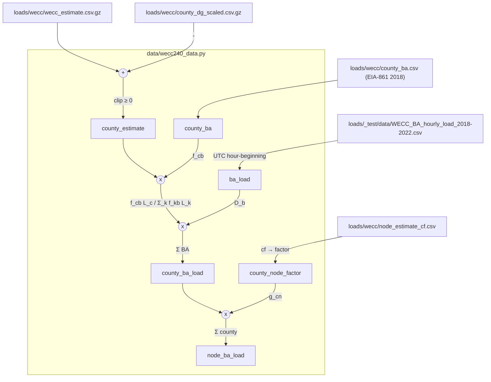

## WECC 240 model data flow

## EIA-930 balancing authority load disaggregation

The node loads in `node_ba_load.csv.gz` disaggregate the hourly EIA-930
demand of each US WECC balancing authority (BA) to the counties it serves,
in proportion to each county's hourly contribution to the BA's estimated
load, and then allocate the county loads to the WECC 240 nodes. The inputs
are copied from `eudoxys/loads` at commit `LOADS_COMMIT` (see
`wecc240_data.py`).

Files:

- `ba_load.csv.gz`: cleaned EIA-930 hourly demand (MW) of the 28 US WECC
  BAs that report demand, `timestamp` UTC hour-beginning, 2018-2022 (the
  first 8 hours of 2018 are missing in the source).
- `county_ba.csv`: fraction of each county's load served by each BA
  (`county_st`, `ba`, `factor`, `method`).
- `county_node_factor.csv`: fraction of each county's load allocated to each
  node (`county_st`, `node`, `factor`, `method`).
- `county_ba_load.csv.gz`: county hourly net load (MW) disaggregated from
  EIA-930.
- `node_ba_load.csv.gz`: node hourly net load (MW) disaggregated from
  EIA-930 (113 US-load nodes, by geohash).

Checks (2018-2022): for every hour with EIA-930 data, the total node load
equals the EIA-930 WECC US total plus the uncalibrated share of the counties
served by `SWPP` (about 3 TWh/y) to within rounding; no node load is
negative.

| Year | EIA-930 TWh | Node TWh | Node peak MW |
|---|---|---|---|
| 2018 | 728.6 | 731.6 | 139,897 |
| 2019 | 718.7 | 721.7 | 133,141 |
| 2020 | 718.1 | 721.1 | 141,287 |
| 2021 | 724.7 | 727.6 | 136,203 |
| 2022 | 744.2 | 747.1 | 143,500 |
